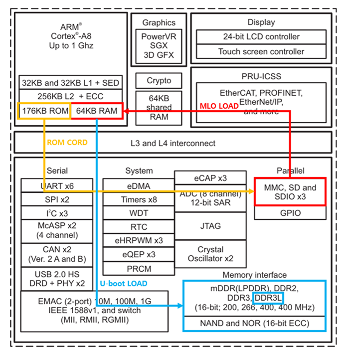

# BeagleBone Black boot notes

## Setup

I used Ubuntu 26.04 on WSL2 and U-Boot 2021.01.

1. Install a cross-compiler for the BBB.
2. Install the packages below. I installed other packages as needed, so this may not be the full list.

   ```text
   autoconf automake bison bzip2 cmake flex g++ gawk gcc gettext git gperf help2man libncurses5-dev
   libstdc++6 libtool libtool-bin make patch python3-dev rsync texinfo unzip wget xz-utils
   ```

3. Create two SD card partitions: 64 MiB FAT32 first, then 1 GiB ext4.
4. Configure and build U-Boot with the cross-compiler. Copy `MLO` and `u-boot.img` to the first partition.

   ```bash
   make ARCH=arm CROSS_COMPILE=arm-cortex_a8-linux-gnueabi- am335x_evm_defconfig
   ```

5. Connect a serial adapter to the J1 debug UART header.
6. Open a serial terminal. I used MobaXterm with 115200 baud, 8 data bits, no parity, 1 stop bit, and no flow control.
7. Insert the SD card, hold S2, and apply power. Press a key to interrupt autoboot and get the U-Boot prompt.

From there, U-Boot can load a bare-metal program, an RTOS, or Linux.

## Boot sequence

### ROM code

The AM335x Boot ROM loads the SPL (`MLO`) into internal SRAM and jumps to it. The SRAM size noted here is 64 KiB.

### SPL

The SPL runs from SRAM, initializes DDR, and loads `u-boot.img` into DRAM.

### U-Boot

U-Boot provides the command prompt and can load a kernel, FDT, and initial RAM disk. DDR needs to be ready before anything runs from DRAM.



In this setup, `MLO` initializes the 512 MB DDR and loads `u-boot.img`, which then opens the command prompt.

## Next

- Write my own `MLO` to initialize DDR and load the next stage.
- Or use U-Boot to load my RTOS or a bare-metal program first.
