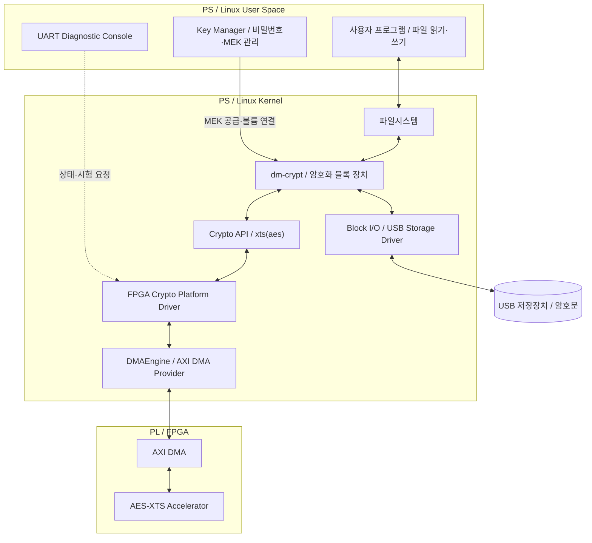
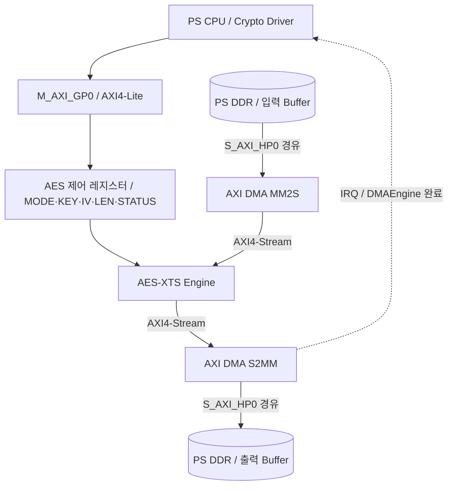
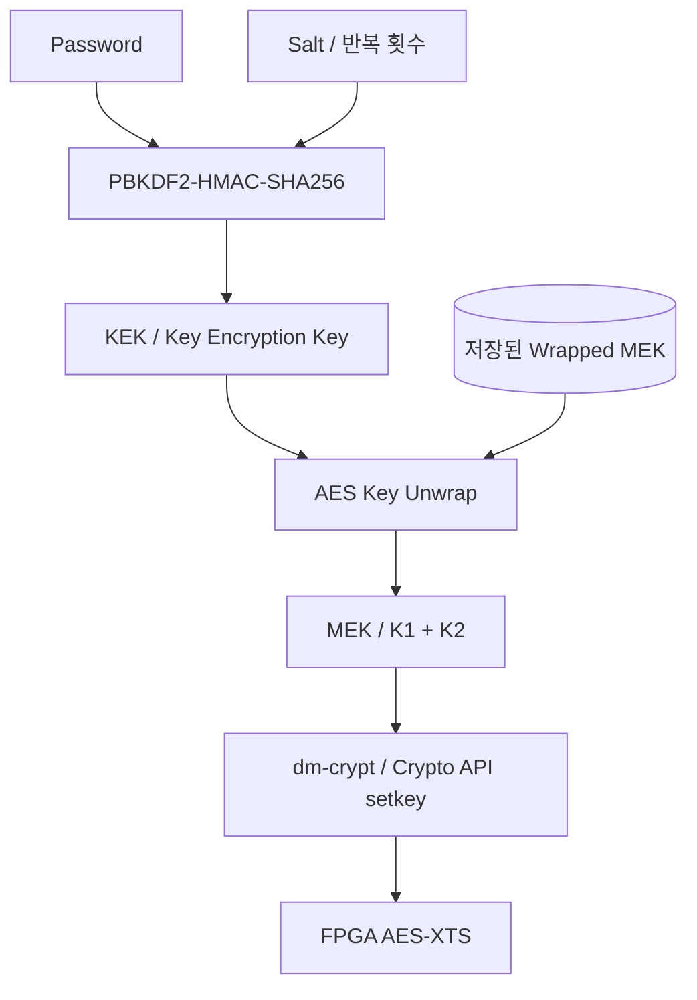

# Zynq SoC 기반 AES-XTS 하드웨어 가속 보안 스토리지 시스템

> Linux 표준 저장장치 암호화 경로와 FPGA AES-XTS 가속기를 연동하는 HW/SW 통합 프로젝트

**개발 기간: 4주 · 개발 인원: 3명 · 현재 상태: 구현·검증 완료 항목 없음**

## 1. 프로젝트 개요

| 항목 | 계획 |
|---|---|
| 팀 | 럭키커널 / Lucky Kernel |
| 개발 목적 | Linux 저장장치 암호화의 FPGA 연산 가속 및 PS–PL 통합 검증 |
| 대상 보드 | Zybo Z7-20 / Zynq-7000 SoC |
| PS 역할 | Linux, 저장장치 I/O, 키 관리, Crypto Driver, DMA 요청, 진단 |
| PL 역할 | AES-XTS 암·복호화, AXI4-Lite 제어, AXI4-Stream 데이터 처리 |
| 언어·도구 | C, Verilog, Vivado, Embedded Linux, OpenSSL |
| 최종 연동 | Device Tree → Platform Driver → DMAEngine → Crypto API → dm-crypt |
| 대상 저장장치 | 별도 USB 저장장치 우선 제안 / 정확한 장치·용량 미정 |
| 개발 일정 | 착수일 기준 4주 / 시작일·종료일 미정 |
| 문서 성격 | 구현 전 계획서 / 아래 설계값·역할·일정 배분은 제안 |

**문서 구성**

- [목표·범위](#2-개발-목표와-범위)
- [전체 아키텍처](#3-전체-시스템-아키텍처)
- [PS–PL 인터페이스](#4-pspl-데이터제어-구조)
- [Linux 드라이버](#6-linux-소프트웨어-설계)
- [키 관리](#7-키-관리-설계)
- [진단 콘솔](#8-uart-개발자-진단-콘솔)
- [검증·성능](#10-검증-계획)
- [4주 일정·3명 역할](#12-4주-개발-일정)

## 2. 개발 목표와 범위

### 2.1 개발 배경

- 적용 대상: 차량 데이터 로거, 산업용 Edge Device, 보안 저장장치
- 해결 과제: 저장매체 분실·분리 시 저장 데이터 노출 방지
- 구현 관점: Host/SoC에서 키와 암호화 정책 관리
- 기술 과제: Linux 표준 Crypto/Storage Framework와 FPGA 가속기 연결
- 검증 관점: 암호화 정확성, 실제 저장·재읽기, 하드웨어 경로 사용, 성능·CPU 사용률

### 2.2 최종 개발 목표

| 구분 | 개발 내용 | 완료 기준 |
|---|---|---|
| FPGA | AES-XTS 암·복호화 RTL | 동일 키·IV·입력의 결과가 Golden Model과 일치 |
| PS–PL | MMIO, AXI DMA, IRQ | DDR 왕복 전송·완료 통지·오류 복구 검증 |
| Linux | Device Tree, Platform/Crypto Driver | 장치 바인딩 및 `xts(aes)` 구현 등록 |
| 저장장치 | Crypto API·dm-crypt 연동 | 암호화 볼륨의 파일 쓰기·읽기·재오픈 성공 |
| 키 관리 | PBKDF2-HMAC-SHA256, KEK/MEK, AES Key Wrap | 정상 비밀번호로 키 복원·볼륨 해제, 잘못된 비밀번호 거부 |
| 진단 | UART Developer Diagnostic Console | MMIO·DMA·AES-XTS·IRQ·Driver 상태 및 오류 단계 확인 |
| 성능 | SW/FPGA 비교 | 동일 조건의 처리량·지연·CPU 사용률 측정 결과 확보 |

### 2.3 단계별 범위

| 단계 | 범위 | 최종 시스템과의 관계 |
|---|---|---|
| A. 암호 검증 | OpenSSL Golden Vector, AES/XTS RTL Simulation | 연산 정확성 기준 |
| B. 메모리 경로 | DDR → DMA → FPGA → DMA → DDR | 데이터 경로 선행 검증 |
| C. 파일 검증 | FPGA 암호화 결과의 USB 파일 저장·재읽기·복호화 | 저장매체 왕복 검증 / dm-crypt 연동 전 단계 |
| D. 표준 경로 | Crypto API·dm-crypt·실제 블록 장치 연동 | 최종 저장장치 암호화 경로 |
| E. 운영 검증 | 키 관리·진단·성능·오류 처리 | 최종 통합 시연 |

**확장 항목**

- 독립 4KiB 암호화 단위, AES-256-XTS, 다중 요청 성능 최적화
- Recovery Key, 키 백업·회전·폐기, Cryptographic Erase
- TCG Opal 및 SSD 내부 보안 구조 학습

**본 개발 범위 밖**

- NAND Controller, FTL, ECC, PCIe/NVMe Controller 자체 구현
- SSD 내부 SED 기능·TCG Opal 호환 제품 구현
- LUKS2 포맷·Keyslot 자체 구현
- 데이터 인증·변조 탐지의 완전한 구현, 제품 수준 보안 인증

## 3. 전체 시스템 아키텍처

### 3.1 최종 저장장치 연동 구조

- **연산 요청:** dm-crypt → Crypto API → FPGA Crypto Driver → DMAEngine → PL
- **저장 경로:** 암호화 완료 → dm-crypt → Block I/O → USB 저장장치
- **읽기 경로:** USB 암호문 읽기 → 동일 경로의 FPGA 복호화 → 파일시스템에 평문 반환
- **Device Tree:** AES 레지스터·IRQ·DMA 채널·Clock 정보를 Driver에 제공
- **Software 비교군:** 동일한 Crypto API의 SW 구현 사용 / FPGA 사용 여부 별도 확인

dm-crypt는 Kernel Crypto API를 이용하는 블록 장치 암호화 계층이다. FPGA 연산 완료 후 저장장치 I/O는 Linux 저장장치 계층이 처리한다. [Linux dm-crypt 문서](https://docs.kernel.org/admin-guide/device-mapper/dm-crypt.html)

### 3.2 경로별 책임

| 경로 | 시작 → 도착 | 담당 내용 |
|---|---|---|
| 데이터 | PS DDR → AXI DMA → AES-XTS → AXI DMA → PS DDR | 평문·암호문 이동 |
| 제어 | CPU → M_AXI_GP0 → AXI4-Lite → AES 제어 레지스터 | 키·IV·모드·길이·시작·상태 |
| 완료 | DMA IRQ → DMA Provider → Crypto Driver → Crypto API | 전송 완료·연산 상태 확인·요청 완료 |
| 키 | Password → PBKDF2 → KEK → MEK Unwrap → Crypto setkey | 저장 키 보호·런타임 키 공급 |
| 진단 | PC UART → Linux Console → 제한된 진단 인터페이스 | 상태·Self-test·오류 원인 확인 |

## 4. PS–PL 데이터·제어 구조

### 4.1 하드웨어 구성

| 블록 | 역할 | 설계 항목 |
|---|---|---|
| Zynq PS | Linux 실행·DDR·저장장치 관리 | PS 설정, HP/GP Port, IRQ 연결 |
| AXI Interconnect | PS–PL 주소·데이터 연결 | 주소 배치, 데이터 폭, Clock/Reset |
| AXI DMA | DDR와 Stream 간 데이터 전송 | MM2S/S2MM, 정렬, 최대 전송 길이, SG 지원 설정 |
| AES Core | AES Encrypt/Decrypt | 재사용 IP 선정·라이선스·지원 키 길이 확인 |
| XTS Wrapper | Tweak 생성·블록별 갱신·암복호화 연결 | Data Unit 경계, Byte Order, 키 분리 |
| AXI4-Lite Slave | CPU 제어·상태 접근 | Register Map, START, BUSY, DONE, ERROR |
| AXI4-Stream Wrapper | DMA와 AES-XTS 연결 | TVALID/TREADY/TLAST, Backpressure, TKEEP 사용 규칙 |
| ILA | 하드웨어 동작 관측 | Stream Handshake, 데이터 길이, 완료·오류 신호 |

AXI DMA의 MM2S/S2MM 및 동작 모드는 [AMD PG021](https://docs.amd.com/r/en-US/pg021_axi_dma)을 기준으로 설정한다.

### 4.2 AES 제어 레지스터 제안

| 항목 | 용도 | 정책 |
|---|---|---|
| ID / VERSION | IP 식별·버전 확인 | 읽기 전용 |
| CONTROL | START, 암복호화 선택, ZEROIZE | BUSY 중 변경 제한 |
| STATUS | BUSY, DONE, ERROR, KEY_VALID | 완료·오류 Clear 규칙 명시 |
| LENGTH | 요청 처리 길이 | 지원 길이·단위 경계 검증 |
| DATA_UNIT_IV | 암호화 단위 식별값 | Linux IV 규칙과 동일하게 전달 |
| KEY_K1 / KEY_K2 | XTS 데이터 키·Tweak 키 | 쓰기 전용 제안 / 읽기 시 키 반환 금지 |
| ERROR_CODE | 길이·상태·프로토콜 오류 | UART·Driver 진단에 사용 |

- Register Offset·Base Address·IRQ 번호: Vivado Address Editor 및 Device Tree 확정 후 기입
- AES 키·IV 제어와 DMA 제어의 소유권 분리
- DMA Register의 상시 제어: AXI DMA Provider Driver 담당
- Crypto Driver의 DMA 요청: DMAEngine API 사용
- 진단 도구의 임의 DMA Register 쓰기: 운영 I/O와 동시 사용 금지

## 5. 암호·데이터 형식

| 항목 | 1차 설계 제안 | 확장·검증 |
|---|---|---|
| AES-XTS 모드 | AES-128-XTS | AES-256-XTS 지원은 RTL 자원·일정 검토 후 확장 |
| MEK 구성 | K1 128bit + K2 128bit = 총 256bit | AES-256-XTS 사용 시 총 512bit |
| AES Block | 16B | 블록 순서·Endianness 검증 |
| 암호화 Data Unit | 512B | 독립 4KiB 단위는 별도 확장 |
| 4KiB 요청 | 512B Data Unit 8개로 분할 | 단위마다 IV/Tweak 재초기화 |
| IV 방식 | dm-crypt `aes-xts-plain64`와 일치 | Sector 번호·IV Offset·Byte Order 고정 |
| 초기 입력 범위 | 512B의 정수배 | 임의 길이·CTS 지원은 기본 시연 범위에서 제외 |
| 검증 기준 | 동일 K1/K2·IV·Data Unit·입력 → 동일 암호문 | SW/RTL/실기 상호 비교 |

- **용어 통일:** 기존 README의 DEK는 본 문서의 MEK와 같은 데이터 암호화 키 역할
- **키 길이 주의:** AES-XTS의 전체 키 길이와 개별 AES 키 길이 구분. [OpenSSL AES 문서](https://docs.openssl.org/3.5/man3/EVP_aes_128_gcm/)
- **IV 경계:** 단순 파일 Offset·물리 USB LBA를 혼용하지 않고 dm-crypt가 사용하는 암호화 단위 번호를 기준으로 정의
- **4KiB 확장:** `sector_size` 및 `iv_large_sectors` 설정에 따른 IV 차이 별도 검증. [dm-crypt IV 규칙](https://docs.kernel.org/admin-guide/device-mapper/dm-crypt.html)
- **보호 범위:** XTS는 저장 데이터 기밀성 제공 / 데이터 인증·변조 탐지는 별도 설계 과제. [NIST SP 800-38E](https://csrc.nist.gov/pubs/sp/800/38/e/final)

## 6. Linux 소프트웨어 설계

### 6.1 모듈별 책임

| 모듈 | 구현 내용 | 산출물 |
|---|---|---|
| Device Tree | compatible, reg, clocks, interrupts, dmas, dma-names | DTS/DTSI 또는 Overlay |
| Platform Driver | probe/remove, MMIO 자원 확보, 장치 초기화·정리 | Kernel Module |
| DMA Client | 채널 요청, Buffer 준비·매핑, 전송·완료·중단 | DMA Loopback·암호화 전송 코드 |
| Crypto Driver | skcipher 등록, setkey, encrypt/decrypt, 비동기 완료 | `xts(aes)` Provider |
| Key Manager | MEK 생성·Wrap/Unwrap·비밀번호 변경·잠금 | User-space C 도구 |
| Volume Manager | dm-crypt Mapping 생성·해제·재오픈 | 실행 도구·설정 파일 |
| Diagnostic Tool | 제한된 상태 조회·시험 요청 | UART CLI |
| Test/Benchmark | Golden 비교, 파일·블록 검증, 성능 측정 | 테스트·CSV·측정 기록 |

### 6.2 암호 요청 처리 순서

1. Crypto API 요청에서 입력·출력 Scatterlist, 길이, IV 확인
2. Key Context·Data Unit 경계·장치 상태 검증
3. Driver 소유 전송 Buffer 또는 적절한 DMA Mapping 준비
4. MMIO로 AES 모드·키·IV·길이 설정
5. S2MM 수신 준비 후 MM2S 입력 전송 시작
6. DMA 완료 Callback 및 AES 상태 확인
7. TX/RX 종료 확인, 필요한 동기화·결과 복사·자원 정리
8. Crypto API 요청 완료 통지 / 실패 시 오류 반환

**구현 원칙**

- 1차: 요청 직렬화·제한된 Buffer·명확한 오류 복구 우선
- Scatterlist 비연속 메모리·Data Unit 분할 처리 포함
- DMA 주소·CPU 가상주소 구분 / 실제 DMA 장치에 맞는 매핑 사용
- 전송 완료 전 Buffer 재사용·해제 금지
- Timeout·Reset 시 DMA 중단 후 자원 정리·진행 요청 종료
- IRQ/Callback에서 긴 대기·Blocking 작업 배제
- Cipher Context별 키 보관, 하드웨어 접근 직렬화, 키 교체·제거 시 정리
- DMA 직접 Register 실험 코드는 초기 Bring-up에 한정 / DMAEngine 동시 제어 금지

참조: [DMAEngine Client API](https://docs.kernel.org/driver-api/dmaengine/client.html), [skcipher API](https://docs.kernel.org/crypto/api-skcipher.html)

### 6.3 실제 FPGA 경로 사용 확인

- `xts(aes)` 공통 이름 및 고유 Driver 이름 등록
- `/proc/crypto`에서 Driver 이름·Priority 확인
- FPGA Driver 처리 요청 수·처리 Byte·IRQ/DMA 완료 수 계측
- dm-crypt 실제 파일 I/O 전후 FPGA Counter 증가 확인
- SW 비교 시 FPGA Provider를 배제하거나 명시적인 SW Provider 선택
- HW 실패 후 자동 SW Fallback 사용 여부를 측정 기록에 표시

알고리즘 등록만으로 dm-crypt의 FPGA 사용을 입증할 수 없으므로 실제 요청 Counter를 함께 확인한다. [Kernel Crypto API 선택 규칙](https://kernel.org/doc/html/latest/crypto/architecture.html)

## 7. 키 관리 설계

### 7.1 키 계층

### 7.2 생성·해제·잠금

| 단계 | 처리 | 저장·정리 정책 |
|---|---|---|
| 초기 생성 | 암호학적 난수로 MEK·Salt 생성 | MEK는 Password에서 직접 생성하지 않음 |
| KEK 생성 | Password + Salt + 반복 횟수 → PBKDF2-HMAC-SHA256 | 반복 횟수는 보드에서 Unlock 시간 측정 후 확정 |
| 키 저장 | KEK로 MEK를 AES Key Wrap | Password·평문 KEK·평문 MEK 영구 저장 금지 |
| 볼륨 해제 | 동일 KDF → MEK Unwrap → dm-crypt에 공급 | Unwrap 실패 시 Mapping 생성 금지 |
| 비밀번호 변경 | 같은 MEK를 새로운 KEK로 다시 Wrap | 데이터 전체 재암호화와 구분 |
| 잠금 | I/O 종료 → Unmount → Mapping 해제 → 키 정리 | Driver Context·PL 키 상태 포함 |
| MEK 변경 | 새 MEK로 데이터 재암호화 | KEK 교체와 구분 / 확장 항목 |

- KEK 길이 제안: 256bit / AES-256 Key Wrap
- 비밀번호 입력: Terminal Echo 비활성화 / 명령행 인자·로그로 키 전달 금지
- Key Manager → dm-crypt: libcryptsetup 또는 제한된 메모리·FD 전달 방식 검토
- 키 관리 구현: User Space / 데이터 암복호화: PL
- AES Key Wrap은 키 보호에 사용하며 데이터 XTS의 인증 기능으로 간주하지 않음

참조: [OpenSSL PBKDF2](https://docs.openssl.org/3.5/man7/EVP_KDF-PBKDF2/), [NIST Key Wrapping](https://csrc.nist.gov/pubs/sp/800/38/f/final)

### 7.3 저장 메타데이터 제안

| 분류 | 필드 |
|---|---|
| 형식 | Magic, Format Version, Volume UUID |
| 암호 | Cipher, MEK Length, Wrap Algorithm |
| KDF | Hash, Salt, Iteration Count |
| 저장 영역 | Payload Offset, Data Unit Size, IV Mode, IV Offset |
| 보호된 키 | Wrapped MEK |
| 유효성 | 길이·범위·지원 버전 검사 / 변조 검사 방식 구현 전 확정 |

- 학습용 전용 Key Metadata + dm-crypt Plain Mapping 구성 제안
- 키 메타데이터 파일·저장 위치·백업 방식: 1주차 확정
- 일반 볼륨 생성 작업이 Key Metadata를 덮어쓰지 않도록 영역 분리
- 사용자 정의 AES Key Wrap 형식을 LUKS2 Keyslot과 동일한 형식으로 표기하지 않음
- 초기 구현은 LUKS2 호환성보다 두 문서의 키 계층과 dm-crypt 경로 연결 검증에 집중

### 7.4 복구·키 수명주기 확장

| 상황 | 대응 방향 | 개발 범위 |
|---|---|---|
| 비밀번호 분실 | 별도 Recovery KEK로 같은 MEK를 보호한 복구 Slot | 확장 |
| Controller·FPGA 교체 | 동일 MEK·IV 규칙·메타데이터를 사용한 SW 복호화 | 설계·벡터 검증 |
| 키 메타데이터 손상 | Wrapped MEK·필수 메타데이터 백업·복원 | 방식 설계 / 구현은 일정 검토 |
| 전원 차단 | 메타데이터 갱신의 원자성·일관성 검증 | 기본 오류 검토 |
| Recovery Key 유출 | 별도 보관·접근 권한·운영 절차 | 확장 설계 |
| 키 전체 분실 | 유효 MEK·복구 수단 없으면 복구 불가 | 한계 명시 |
| Cryptographic Erase | 키·Wrapped Copy·백업·메모리 잔여의 폐기 범위 정의 | 확장 / 삭제 효과 과장 금지 |

**보호 가정**

- 잠긴 상태의 저장매체 분리·열람을 주요 시연 대상으로 설정
- 신뢰하는 Linux Kernel·Root·FPGA Bitstream 가정
- Root 권한 탈취, 실행 중 RAM 추출, 물리적 Side-channel, 보안 부팅 우회는 별도 과제
- PS에서 PL로 키를 공급하는 구조이며 Hardware Root of Trust 구현으로 표기하지 않음

## 8. UART 개발자 진단 콘솔

**구성 제안:** PC ↔ PS UART ↔ Linux Terminal ↔ C Diagnostic CLI ↔ Driver 상태·Self-test 인터페이스

| 명령 예시 | 조회·시험 내용 | 관찰 지점 |
|---|---|---|
| `status` | Driver Bind·키 설정 여부·Idle/Busy·마지막 오류 | 전체 상태 |
| `mmio-test` | IP ID·Version·허용된 시험 Register | AXI4-Lite |
| `dma-test` | Known Pattern Loopback·길이·완료·비교 | DDR·DMA |
| `aes-test` | AES/XTS Known Vector 결과 | 연산부 |
| `irq-stat` | DMA Callback·IRQ·완료 수 | 완료 경로 |
| `crypto-stat` | 요청 수·Byte·실패·현재 Provider | 실제 가속 사용 |
| `selftest` | MMIO → DMA → AES-XTS 순차 진단 | 단계별 PASS/FAIL |
| `recover` | 유휴·장애 상태에서 통제된 재초기화 | Timeout·Reset |

- 명령명: 구현 전 제안 / 실제 실행 가능한 명령으로 간주하지 않음
- 상태 출력: 요청 ID, 단계, 길이, 소요시간, 오류 코드 중심
- Password·KEK·MEK·Key Register 값 출력 금지
- 운영 I/O 중 위험한 Self-test·Reset·임의 Register 변경 차단
- 통합 Driver와 같은 상태·잠금 체계를 사용해 진단과 운영 경로 충돌 방지

## 9. 주요 동작 시나리오

### 9.1 저장장치 쓰기

1. Password 입력 → KEK 생성 → MEK Unwrap
2. dm-crypt Mapping 생성 → 파일시스템 Mount
3. 사용자 파일 쓰기 → dm-crypt 암호화 요청
4. Crypto Driver가 키·IV·DMA 전송 준비
5. PL AES-XTS 암호화 → DDR 결과 반환
6. 요청 완료 → Linux Block I/O → USB에 암호문 저장

### 9.2 읽기·재오픈

1. USB의 암호문 읽기 → dm-crypt 복호화 요청
2. 동일 MEK·Data Unit·IV로 FPGA 복호화
3. 파일시스템에 평문 반환 → 원문 Hash·Byte 비교
4. Unmount·Mapping 해제 → 키 상태 정리
5. 재부팅 후 같은 Password·Metadata로 재오픈 검증

### 9.3 잘못된 비밀번호·통신 장애

- 잘못된 Password: Unwrap 실패 → Mapping 생성 중단
- DMA Timeout: 전송 중단 → Buffer 정리 → 요청 실패 반환 → 진단 기록
- AES 오류: ERROR_CODE 확인 → 결과 사용 차단 → 필요 시 재초기화
- 장치 제거: 신규 요청 차단 → 진행 요청 종료 → 키·자원 정리
- 복구 검증: 장애 처리 후 다음 정상 요청 성공 여부 확인

## 10. 검증 계획

| ID | 검증 대상 | 입력·방법 | 통과 기준 |
|---|---|---|---|
| T01 | Golden Model | OpenSSL EVP 기반 C 도구·고정 키/IV/입력 | 재현 가능한 Vector·결과 파일 확보 |
| T02 | AES RTL | Encrypt/Decrypt Known Vector | 기대값과 Bit-exact |
| T03 | XTS RTL | 512B, LBA 0/1, 연속 단위 | Golden과 암호문·복호문 일치 |
| T04 | DMA Loopback | Known Pattern·서로 다른 길이 | 입력=출력, 완료 통지, Timeout 없음 |
| T05 | FPGA Crypto | DDR → DMA → AES-XTS → DDR | SW와 Bit-exact / Round-trip 성공 |
| T06 | Kernel Crypto | setkey, encrypt/decrypt, 다중 Context | 키·IV 혼선 없음 / 비동기 요청 정상 완료 |
| T07 | 실제 가속 사용 | dm-crypt I/O + HW Counter | Driver·처리 Byte·DMA 완료 증가 |
| T08 | 파일 선행 검증 | 암호문 파일 저장→재읽기→복호화 | 원문 Byte·Hash 일치 |
| T09 | dm-crypt 볼륨 | 파일 생성·읽기·동기화·재오픈 | 원문 일치 / SW 구현과 상호 복호화 |
| T10 | 키 관리 | 정상·오입력·비밀번호 변경 | 정상 해제 / 오입력 거부 / 변경 후 재오픈 |
| T11 | 예외 처리 | 잘못된 길이·Timeout·Reset | 자원 정리·오류 반환·후속 정상 요청 성공 |
| T12 | 성능 | SW/HW 동일 조건 반복 측정 | 원시 결과·환경·측정 경계 기록 |

**추가 확인 사항**

- 4KiB 요청은 8개 512B 단위로 비교 / 하나의 4KiB XTS 단위와 혼동 금지
- 같은 평문·키에서 다른 Data Unit 번호의 암호문 차이 확인
- FPGA ↔ SW 교차 복호화로 Vendor/IP 종속성 점검
- 저장매체의 단순 평문 문자열 검색만으로 암호화 정확성·보안성을 판정하지 않음
- 사용 중인 Root/Boot 저장매체와 실험용 저장 영역 분리
- 실행 환경·Kernel Config·Bitstream·소스 Commit·키 길이·IV 규칙을 검증 기록에 포함

## 11. 성능 측정 계획

### 11.1 측정 경계

| 구분 | 측정 범위 | 비교 목적 |
|---|---|---|
| RTL Core | AES-XTS 입력 수락 → 출력 완료 | Cycle·Core 처리량 |
| Crypto 요청 | Driver 요청 접수 → 완료 Callback | 복사·DMA·IRQ 포함 HW Offload 비용 |
| Storage I/O | 파일/Block I/O 시작 → 동기화된 완료 | 실제 저장장치 경로의 효과 |

### 11.2 측정 조건·지표

- 동일 보드·CPU 조건·Cipher·키 길이·Data Unit·입출력 크기 사용
- SW 비교는 동일 Kernel Crypto 경로 우선 / OpenSSL 단독 수치는 별도 표기
- Warm-up 후 반복 측정 / 반복 횟수·입력 크기·동시 요청 수 기록
- Buffered I/O와 Direct I/O, Cache 영향, `fsync` 포함 여부 구분
- 작은 요청의 DMA 준비·복사·IRQ 비용과 저장매체 병목 별도 분석
- 목표는 가속 여부·병목을 측정하는 것 / 사전 측정 없이 속도 향상 수치 제시 금지

| 지표 | 단위 | 기록 항목 |
|---|---|---|
| 처리량 | MiB/s | Encrypt/Decrypt, SW/HW |
| 지연 | us 또는 ms | 평균·분포·상위 지연 |
| CPU 사용 | CPU Time, CPU Utilization | 측정 도구·측정 구간 |
| FPGA 자원 | LUT, FF, BRAM, DSP | 합성·구현 보고서 |
| Clock·Timing | MHz, WNS, Fmax | 적용 Clock·Timing 충족 여부·최대 동작 주파수 평가 |
| 신뢰성 | 건수 | 오류·Timeout·재시도·복구 성공 |

**현재 측정 결과: 없음 / 측정 후 결과 표·원시 CSV·분석 추가**

## 12. 4주 개발 일정

| 주차 | Linux/Driver | FPGA/RTL | Key·검증·통합 | 주간 완료 기준 |
|---|---|---|---|---|
| 1주 | Linux 부팅·DT/MMIO·SW dm-crypt 기준선 | AES IP 선정·AES/XTS TB·AXI/DMA 기본 설계 | Golden Vector·키 형식·시험 규칙·UART CLI 골격 | 환경 고정, Golden 재현, SW 볼륨 동작, 인터페이스 명세 |
| 2주 | DMAEngine Loopback·IRQ·Crypto Driver 골격 | XTS 암복호화·Stream·Register·실기 통합 | Key Wrap/Unwrap·파일 검증 도구·자동 비교 | DMA 왕복 및 FPGA 암복호화 Golden 일치 |
| 3주 | skcipher 등록·요청 처리·dm-crypt 연결 | HW 오류·Reset·Timing·ILA 디버깅 | Password→MEK→Mapping·진단 명령 통합 | 실제 HW 사용을 증명한 파일 I/O·키 해제 |
| 4주 | Timeout·동시성·제거 처리·통합 수정 | 기능 안정화·자원/Timing 보고서 | 재오픈·예외·SW/HW 측정·발표·시연 | 통합 검증·재현 자료·성능 보고서 |

**일정 운영**

- 1주차에 SW dm-crypt·Key Manager를 먼저 검증해 FPGA 통합 의존도 분리
- 2주차에는 반복 가능한 최소 HW 암복호화 왕복 확보
- 3주차에는 End-to-end 통합을 우선 완료하고 최적화는 이후 수행
- Gate 미통과 시 미완료 범위를 명시 / 선행 단계 성공을 최종 dm-crypt 완료로 표기하지 않음
- 우선순위 조정: 성능 최적화·독립 4KiB 단위·Recovery 확장 → 기본 통합 완료 후

## 13. 3명 역할 분담 제안

| 담당 | 주 책임 | 공동 연동·검증 | 핵심 산출물 |
|---|---|---|---|
| A — Linux/Driver | Device Tree, Platform Driver, DMAEngine, Crypto API, IRQ·Timeout | B와 Register/Stream 합의, C와 dm-crypt 연결 | DTS·Kernel Module·Driver 시험 결과 |
| B — FPGA/RTL | AES-XTS RTL, AXI4-Lite/Stream, DMA Block Design, Clock/Reset | A와 PS–PL 통합, C와 Golden 비교 | RTL·TB·Bitstream·자원/Timing 보고서 |
| C — Key/Test/System | Golden Model, Key Manager, Volume 도구, UART CLI, Benchmark | A와 진단·키 공급, B와 Vector·ILA 확인 | User 도구·자동 검증·CSV·통합 시연 |

- 실명 배정: 미정
- 각 담당은 코드·명세·개별 검증·통합 수정까지 책임
- 전체 리뷰: 요청 형식, Key/IV 규칙, 오류 코드, Gate 결과

## 14. 단계별 완료 기준과 현재 상태

| Gate | 완료 기준 | 필수 증빙 | 현재 상태 |
|---|---|---|---|
| G0 | 보드·OS·도구·Cipher/IV 규칙 확정 | 환경 명세·부팅 로그 | 미완료 |
| G1 | SW Golden·키 관리 단위 검증 | Vector·Wrap/Unwrap 결과 | 미완료 |
| G2 | AES-XTS RTL 정확성 | TB·파형·비교 결과 | 미완료 |
| G3 | Linux DMA Loopback·IRQ | 전송·완료·비교 로그 | 미완료 |
| G4 | FPGA 메모리 암복호화·파일 왕복 | Golden 일치·Hash·원문 비교 | 미완료 |
| G5 | Crypto API·dm-crypt 실제 HW 경로 | Provider·HW Counter·I/O 결과 | 미완료 |
| G6 | Password Unlock·재오픈·진단·복구 | 시나리오별 PASS/FAIL | 미완료 |
| G7 | SW/HW 성능·자원·통합 시연 | CSV·보고서·재현 절차·영상 | 미완료 |

## 15. 주요 위험과 대응

| 위험 | 영향 | 대응 |
|---|---|---|
| RTL 개발·복호화 지연 | FPGA 통합 일정 지연 | 검증된 AES IP 재사용 검토·초기 Vector 고정 |
| Crypto API/dm-crypt 연결 난도 | 파일 저장만 구현하고 표준 경로 미완료 | 1주차 SW 기준선·2주차 Driver 골격 병행 |
| IV·단위·Endian 불일치 | Round-trip 일부 성공에도 호환성 실패 | Vector 명세·SW/HW 교차 복호화 |
| DMA/TLAST/Cache 문제 | Hang·데이터 손상 | Loopback 분리·ILA·Timeout·매핑 검증 |
| 실제로 SW Provider 사용 | 성능 결론 오류 | HW 요청 Counter·Provider 확인 |
| 키·메타데이터 형식 불명확 | 재오픈·복구 실패 | 1주차 형식 고정·비밀번호 변경·재부팅 시험 |
| USB·복사 비용 병목 | 기대한 속도 향상 미달 | Core/Crypto/System 측정 경계 분리 |
| 4주 내 과도한 확장 | 기본 기능 안정화 시간 부족 | 기본 통합·진단·측정 우선, Recovery 등은 확장 |

## 16. 예상 산출물·시연

### 16.1 산출물

- [ ] 전체 아키텍처·Register Map·Key/IV 명세
- [ ] Vivado Block Design·RTL·Testbench·Bitstream
- [ ] Device Tree·Kernel Config·Crypto Driver
- [ ] OpenSSL Golden Model·Vector·자동 비교 도구
- [ ] Key Manager·Volume 도구·UART Diagnostic CLI
- [ ] 파일·블록·키·오류·재부팅 검증 기록
- [ ] SW/HW 성능 CSV·FPGA 자원/Timing 보고서
- [ ] 설치·빌드·실행·복구 절차 및 최종 시연 영상

### 16.2 최종 시연 순서

1. 보드 부팅 → Driver·FPGA 상태·키 미설정 확인
2. Password 입력 → MEK Unwrap → 암호화 볼륨 해제
3. 파일 쓰기 → FPGA 요청·DMA 완료 Counter 확인
4. 파일 읽기 → 원문 Hash·Byte 일치 확인
5. Mapping 해제 → 잘못된 Password 거부 → 정상 Password 재오픈
6. 진단 Self-test·Timeout/오류 처리·정상 복구 확인
7. SW/HW 처리량·지연·CPU 사용·FPGA 자원 비교

## 17. 착수 시 확정할 항목

| 항목 | 현재 값·결정 기준 |
|---|---|
| Kernel·배포판·Vivado·OpenSSL 버전 | 보드·IP·Driver 호환성 확인 후 고정 |
| 보드·USB·UART 장비 확보 | 보유 여부·비용 미정 |
| AES IP·라이선스·지원 Cipher | 재사용 여부 및 기능 확인 |
| HW 주소·IRQ·Clock·DMA 설정 | Block Design·DT와 동시 고정 |
| Key Metadata·전달·복구 방식 | 학습용 Format·권한·수명주기 합의 |
| 성능 목표 수치 | SW 기준선 측정 후 설정 |
| 실명별 역할·절대 일정 | 3명 배정 및 착수일 확정 |

## 18. 참고 기준

**입력 자료**

- 기존 `fpga_base_secure_storage_controller_datapath_proto/README.md`: PS–PL Datapath, 파일 왕복 검증, 키 복구·수명주기 아이디어
- `6팀_럭키커널_프로젝트 계획서(이).hwp`: Crypto API·dm-crypt, DMAEngine, PBKDF2/AES Key Wrap, Developer Diagnostic Console 목표
- 사용자 확정 조건: 4주·3명·현재 구현/검증 완료 항목 없음·전체 범위 포함

**공식 기술 문서**

- [AMD AXI DMA PG021](https://docs.amd.com/r/en-US/pg021_axi_dma)
- [Linux DMAEngine Client API](https://docs.kernel.org/driver-api/dmaengine/client.html)
- [Linux Kernel Crypto API Architecture](https://kernel.org/doc/html/latest/crypto/architecture.html)
- [Linux skcipher API](https://docs.kernel.org/crypto/api-skcipher.html)
- [Linux dm-crypt](https://docs.kernel.org/admin-guide/device-mapper/dm-crypt.html)
- [OpenSSL AES/XTS](https://docs.openssl.org/3.5/man3/EVP_aes_128_gcm/)
- [OpenSSL PBKDF2](https://docs.openssl.org/3.5/man7/EVP_KDF-PBKDF2/)
- [NIST SP 800-38E — XTS-AES](https://csrc.nist.gov/pubs/sp/800/38/e/final)
- [NIST SP 800-38F — Key Wrapping](https://csrc.nist.gov/pubs/sp/800/38/f/final)

**검토할 오픈소스 후보**

- [secworks/aes](https://github.com/secworks/aes): AES Core 후보 / 지원 모드·키 길이·라이선스 검토 후 채택
- [Xilinx/axi-packaging-and-linux-driver](https://github.com/Xilinx/axi-packaging-and-linux-driver): Custom IP·Linux 연동 참고 후보
- 기존 README의 이름만 기재된 AES-XTS·AXI DMA 후보: 정확한 저장소·지원 기능·라이선스 확인 후 추가

> 본 문서의 아키텍처·일정·Interface·진단 명령은 구현 계획이다. 실제 완료 항목은 Gate별 증빙 확인 후 갱신한다.
