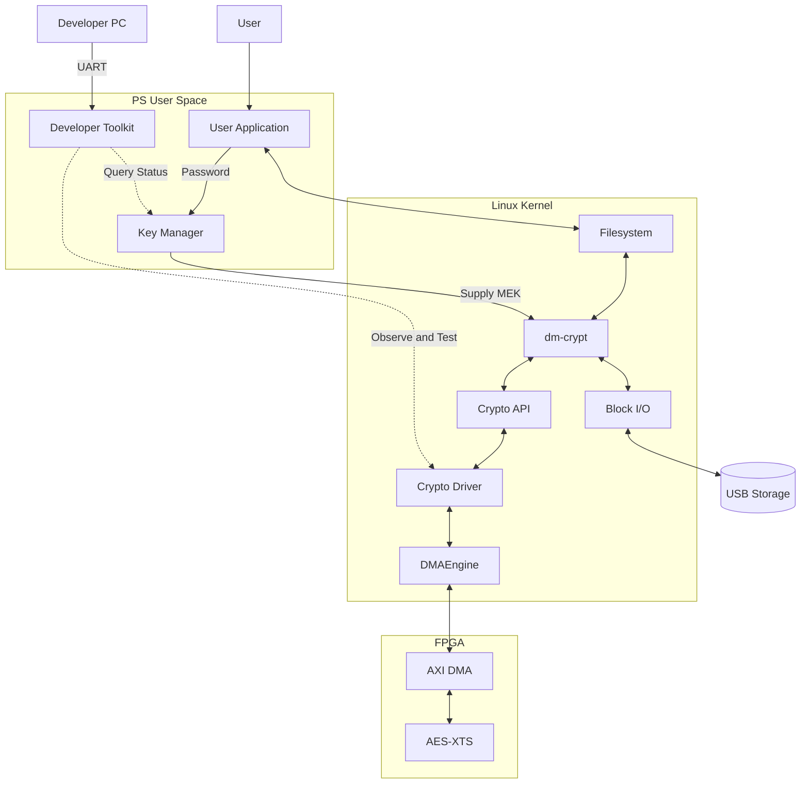
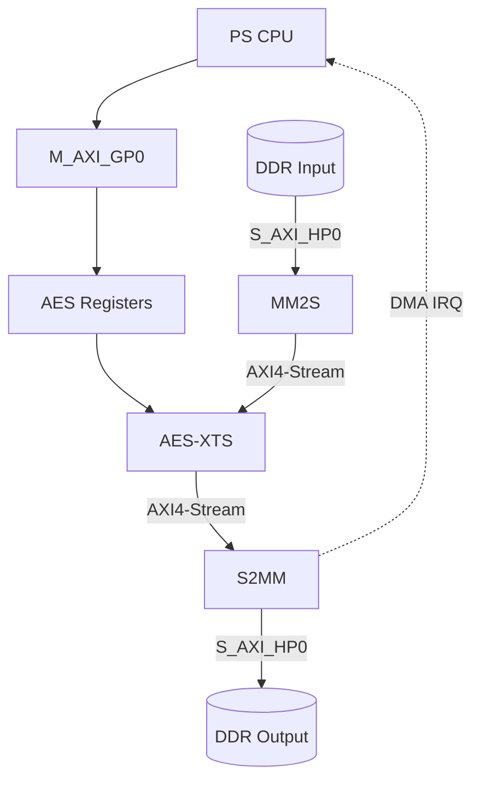
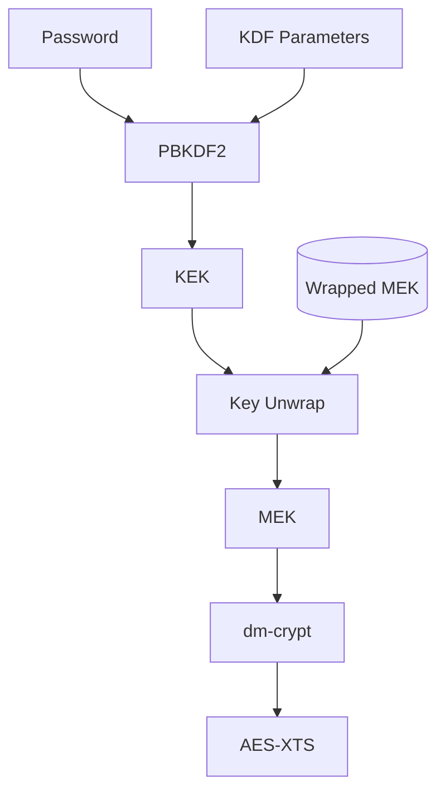
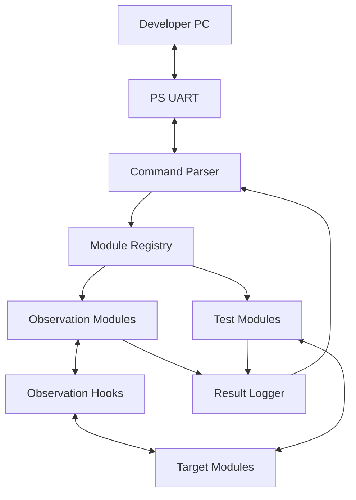

# Zynq SoC AES-XTS Hardware-Accelerated Secure Storage System

> A project to integrate standard Linux storage encryption with an FPGA AES-XTS accelerator and build custom developer verification tools

**Development period: 4 weeks · Team size: 5 (Collaborator: :recycle:[roby238](https://github.com/roby238)) · Current status: No implementation or verification items completed**

**Planning note:** The summary lists five developers, while Sections 13 and 17 still refer to a three-person allocation. This inconsistency is preserved pending confirmation of the team assignments.

## 1. Project Overview

| Item | Plan |
|---|---|
| Team | Lucky Kernel |
| Objective | Accelerate Linux storage encryption on an FPGA and verify PS–PL integration |
| User Features | Enter a password, unlock a volume, and encrypt/decrypt data through file writes and reads |
| Development Tools | A UART verification toolkit that developers can extend with observation points and test commands |
| Target Board | Zybo Z7-20 / Zynq-7000 SoC |
| PS Responsibilities | Linux, storage I/O, key management, crypto driver, DMA requests, and diagnostics |
| PL Responsibilities | AES-XTS encryption/decryption, AXI4-Lite control, and AXI4-Stream data processing |
| Languages and Tools | C, Verilog, Vivado, Embedded Linux, OpenSSL |
| Final Integration | Device Tree → Platform Driver → DMAEngine → Crypto API → dm-crypt |
| Target Storage | A separate USB storage device is proposed first; the exact device and capacity are undecided |
| Schedule | Four weeks from kickoff; start and end dates are undecided |
| Document Status | A pre-implementation plan; the design values, roles, and schedule below are proposals |

**Contents**

- [Goals and Scope](#2-development-goals-and-scope)
- [System Architecture](#3-system-architecture)
- [PS–PL Interface](#4-pspl-data-and-control-structure)
- [Linux Drivers](#6-linux-software-design)
- [Key Management](#7-key-management-design)
- [Developer Verification Tools](#8-uart-developer-verification-toolkit)
- [Verification and Performance](#10-verification-plan)
- [Four-Week Schedule](#12-four-week-development-schedule)
- [Proposed Three-Person Allocation](#13-proposed-three-person-role-allocation)

## 2. Development Goals and Scope

### 2.1 Background

- Target applications: Vehicle data loggers, industrial edge devices, and secure storage
- Problem: Prevent stored data exposure when storage media are lost or removed
- Implementation approach: Manage keys and encryption policies on the host/SoC
- Technical challenge: Connect the standard Linux crypto/storage frameworks to an FPGA accelerator
- Verification focus: Encryption correctness, actual storage and rereading, hardware path usage, performance, and CPU utilization

### 2.2 Final Development Goals

| Area | Planned Work | Completion Criteria |
|---|---|---|
| FPGA | AES-XTS encryption/decryption RTL | Match the golden model for identical keys, IVs, and inputs |
| PS–PL | MMIO, AXI DMA, IRQ | Verify DDR round trips, completion notification, and error recovery |
| Linux | Device Tree, platform/crypto driver | Bind the device and register an `xts(aes)` implementation |
| Storage | Crypto API and dm-crypt integration | Write, read, and reopen files on an encrypted volume successfully |
| Key Management | PBKDF2-HMAC-SHA256, KEK/MEK, AES Key Wrap | Restore keys and unlock with the correct password; reject an incorrect password |
| Development Tools | Extensible UART Developer Toolkit | Observe and unit-test selected layers, and demonstrate adding a verification item |
| Performance | Software/FPGA comparison | Measure throughput, latency, and CPU utilization under identical conditions |

### 2.3 Phased Scope

| Phase | Scope | Relationship to the Final System |
|---|---|---|
| A. Crypto Verification | OpenSSL golden vectors and AES/XTS RTL simulation | Establish computational correctness |
| B. Memory Path | DDR → DMA → FPGA → DMA → DDR | Verify the data path before integration |
| C. File Verification | Save FPGA ciphertext to a USB file, reread it, and decrypt it | Verify a storage round trip before dm-crypt integration |
| D. Standard Path | Integrate the Crypto API, dm-crypt, and a real block device | Complete the storage encryption path |
| E. Operational Verification | Key management, diagnostics, performance, and error handling | Final integrated demonstration |

**Extensions**

- Independent 4 KiB encryption units, AES-256-XTS, and concurrent-request performance optimization
- Recovery keys, key backup/rotation/disposal, and cryptographic erase
- Study of TCG Opal and internal SSD security architecture

**Out of Scope**

- Custom NAND controller, FTL, ECC, or PCIe/NVMe controller implementation
- An SSD-internal SED implementation or a TCG Opal-compatible product
- Custom LUKS2 format or keyslot implementation
- Complete data authentication/tamper detection or product-level security certification

## 3. System Architecture

### 3.1 Final Storage Integration

**Diagram Labels and Responsibilities**

| Label | Responsibility |
|---|---|
| PS User Space / User Application | Linux user space on the PS; file read/write program |
| Key Manager | Password and MEK management and volume mapping |
| User / User Application | Password entry and file writes/reads; GUI or CLI to be decided during implementation |
| Developer PC / Developer Toolkit | Developer-only UART command tool with extensible observation and test commands |
| Linux Kernel | Linux kernel on the PS |
| dm-crypt | Encrypted block-device layer |
| Crypto API | `xts(aes)` encryption/decryption request interface |
| Crypto Driver | FPGA crypto platform driver |
| DMAEngine | DMAEngine API and AXI DMA provider |
| Block I/O | Linux block I/O and USB storage driver |
| AES-XTS | AES-XTS accelerator in the PL |
| USB Storage | USB device that stores ciphertext |

- **Compute request:** dm-crypt → Crypto API → FPGA crypto driver → DMAEngine → PL
- **Write path:** Encryption completes → dm-crypt → Block I/O → USB storage
- **Read path:** Read USB ciphertext → Decrypt through the same FPGA path → Return plaintext to the filesystem
- **Device Tree:** Provide AES register, IRQ, DMA channel, and clock information to the driver
- **Software baseline:** Use a software implementation through the same Crypto API; verify FPGA usage separately

dm-crypt is a block-device encryption layer that uses the Kernel Crypto API. After FPGA computation completes, the Linux storage stack handles storage I/O. [Linux dm-crypt documentation](https://docs.kernel.org/admin-guide/device-mapper/dm-crypt.html)

### 3.2 Responsibilities by Path

| Path | Source → Destination | Responsibility |
|---|---|---|
| Data | PS DDR → AXI DMA → AES-XTS → AXI DMA → PS DDR | Move plaintext and ciphertext |
| Control | CPU → M_AXI_GP0 → AXI4-Lite → AES control registers | Configure keys, IV, mode, length, start, and status |
| Completion | DMA IRQ → DMA provider → Crypto driver → Crypto API | Check transfer completion and computation status, then complete the request |
| Keys | Password → PBKDF2 → KEK → MEK unwrap → Crypto setkey | Protect stored keys and supply runtime keys |
| Development and Verification | Developer PC → UART → Toolkit → Layer-specific observation/test modules | Query selected states, observe repeatedly, run partial tests, and extend functionality |

### 3.3 User Features and Developer Tools

| Area | User Features | Developer Verification Tools |
|---|---|---|
| Purpose | Password-based storage access and file encryption/decryption | Build tools for observing and testing internal information during development |
| Inputs | Password, target file, write/read operation | Query target, observation conditions, test data, length, and iteration count |
| Outputs | Operation success/failure and file results | Status, counters, events, measurements, and comparison results |
| When Used | When writing or reading files | Module development, bring-up, integration, performance analysis, and fault reproduction |
| Operation | Execute encryption and storage for the user request | Run only the selected modules, observation points, and tests |

- Investigating an error after password entry is one example of using the developer tools.
- Tool usage is not limited to running the entire encryption process in a fixed sequence.
- User file operations use ordinary writes and reads after unlocking a dm-crypt volume; an independent per-file encryption format is a separate extension.
- The development goals include both system implementation and **the ability to design and extend the development tools needed for the work**.

## 4. PS–PL Data and Control Structure

**Diagram Labels and Interfaces**

| Label | Meaning |
|---|---|
| PS CPU | PS CPU executing the crypto driver |
| M_AXI_GP0 | AXI4-Lite control path |
| AES Registers | AES control registers: MODE, KEY, IV, LEN, STATUS |
| DDR Input / DDR Output | Input/output buffers in PS DDR |
| MM2S / S2MM | AXI DMA memory-to-stream / stream-to-memory channels |
| AES-XTS | AES-XTS engine |
| S_AXI_HP0 | AXI DMA access path to PS DDR |
| DMA IRQ | Completion notification through DMAEngine after IRQ reception |

### 4.1 Hardware Blocks

| Block | Role | Design Items |
|---|---|---|
| Zynq PS | Run Linux and manage DDR/storage | PS configuration, HP/GP ports, IRQ wiring |
| AXI Interconnect | Connect PS–PL addresses and data | Address allocation, data width, clock/reset |
| AXI DMA | Transfer data between DDR and streams | MM2S/S2MM, alignment, maximum transfer length, SG support |
| AES Core | AES encryption/decryption | Select reusable IP; check licensing and supported key lengths |
| XTS Wrapper | Generate and update tweaks per block; connect encryption/decryption | Data-unit boundaries, byte order, key separation |
| AXI4-Lite Slave | CPU control and status access | Register map, START, BUSY, DONE, ERROR |
| AXI4-Stream Wrapper | Connect DMA and AES-XTS | TVALID/TREADY/TLAST, backpressure, TKEEP rules |
| ILA | Observe hardware behavior | Stream handshakes, data length, completion/error signals |

Configure AXI DMA MM2S/S2MM and operating modes using [AMD PG021](https://docs.amd.com/r/en-US/pg021_axi_dma).

### 4.2 Proposed AES Control Registers

| Register | Purpose | Policy |
|---|---|---|
| ID / VERSION | Identify the IP and version | Read-only |
| CONTROL | START, encryption/decryption selection, ZEROIZE | Restrict changes while BUSY |
| STATUS | BUSY, DONE, ERROR, KEY_VALID | Define completion/error clearing rules |
| LENGTH | Request length | Validate supported lengths and unit boundaries |
| DATA_UNIT_IV | Encryption-unit identifier | Pass according to Linux IV rules |
| KEY_K1 / KEY_K2 | XTS data and tweak keys | Write-only proposed; never return key values on reads |
| ERROR_CODE | Length, state, and protocol errors | Use in UART and driver diagnostics |

- Register offsets, base address, and IRQ number: Fill in after finalizing the Vivado Address Editor and Device Tree.
- Separate ownership of AES key/IV control from DMA control.
- AXI DMA provider driver: Own normal DMA register control.
- Crypto driver: Request DMA transfers through the DMAEngine API.
- Diagnostic tools: Do not allow arbitrary DMA register writes concurrently with operational I/O.

## 5. Cryptography and Data Format

| Item | Initial Design Proposal | Extensions and Verification |
|---|---|---|
| AES-XTS Mode | AES-128-XTS | Extend to AES-256-XTS after reviewing RTL resources and schedule |
| MEK Composition | K1: 128 bits + K2: 128 bits = 256 bits total | 512 bits total for AES-256-XTS |
| AES Block | 16 B | Verify block order and endianness |
| Encryption Data Unit | 512 B | Independent 4 KiB units are a separate extension |
| 4 KiB Request | Split into eight 512 B data units | Reinitialize the IV/tweak for each unit |
| IV Scheme | Match dm-crypt `aes-xts-plain64` | Fix sector numbering, IV offset, and byte order |
| Initial Input Range | Integer multiples of 512 B | Arbitrary lengths and CTS are excluded from the baseline demo |
| Verification Basis | Identical K1/K2, IV, data unit, and input → Identical ciphertext | Cross-check software, RTL, and hardware |

- **Terminology:** DEK in the previous README serves the same data-encryption-key role as MEK in this document.
- **Key lengths:** Distinguish the total AES-XTS key length from each AES key's length. [OpenSSL AES documentation](https://docs.openssl.org/3.5/man3/EVP_aes_128_gcm/)
- **IV boundaries:** Use the encryption-unit number used by dm-crypt; do not mix file offsets and physical USB LBAs.
- **4 KiB extension:** Verify IV differences caused by `sector_size` and `iv_large_sectors` separately. [dm-crypt IV rules](https://docs.kernel.org/admin-guide/device-mapper/dm-crypt.html)
- **Protection scope:** XTS provides confidentiality for stored data; authentication and tamper detection require separate design. [NIST SP 800-38E](https://csrc.nist.gov/pubs/sp/800/38/e/final)

## 6. Linux Software Design

### 6.1 Module Responsibilities

| Module | Planned Implementation | Deliverable |
|---|---|---|
| Device Tree | compatible, reg, clocks, interrupts, dmas, dma-names | DTS/DTSI or overlay |
| Platform Driver | probe/remove, acquire MMIO resources, initialize/clean up the device | Kernel module |
| DMA Client | Request channels, prepare/map buffers, transfer, complete, and abort | DMA loopback and encryption transfer code |
| Crypto Driver | Register skcipher, setkey, encrypt/decrypt, asynchronous completion | `xts(aes)` provider |
| Key Manager | Generate/wrap/unwrap the MEK, change passwords, lock | User-space C tool |
| Volume Manager | Create, remove, and reopen dm-crypt mappings | Execution tools and configuration files |
| Developer Toolkit | Parse commands, register modules, select observation conditions, run partial tests, record results | Extensible UART CLI and observation/test modules |
| Test/Benchmark | Golden comparisons, file/block verification, performance measurement | Tests, CSV files, and measurement records |

### 6.2 Crypto Request Sequence

1. Read the input/output scatterlists, length, and IV from the Crypto API request.
2. Validate the key context, data-unit boundaries, and device state.
3. Prepare driver-owned transfer buffers or appropriate DMA mappings.
4. Configure the AES mode, keys, IV, and length through MMIO.
5. Prepare S2MM reception, then start the MM2S input transfer.
6. Check DMA completion callbacks and AES status.
7. Confirm both TX and RX completion, perform required synchronization/result copies, and release resources.
8. Notify the Crypto API of completion, or return an error on failure.

**Implementation Principles**

- Initial implementation: Prioritize serialized requests, bounded buffers, and clear error recovery.
- Handle noncontiguous scatterlist memory and data-unit splitting.
- Distinguish DMA addresses from CPU virtual addresses; map for the actual DMA device.
- Do not reuse or free buffers before transfer completion.
- On timeout/reset, terminate DMA, release resources, and finish active requests.
- Avoid long waits and blocking operations in IRQ/callback context.
- Store keys per cipher context, serialize hardware access, and clean up when keys are replaced or removed.
- Limit direct DMA register experiments to initial bring-up; never control the same DMA concurrently through DMAEngine.

References: [DMAEngine Client API](https://docs.kernel.org/driver-api/dmaengine/client.html), [skcipher API](https://docs.kernel.org/crypto/api-skcipher.html)

### 6.3 Confirming Actual FPGA Path Usage

- Register both the common algorithm name `xts(aes)` and a unique driver name.
- Check the driver name and priority in `/proc/crypto`.
- Instrument FPGA driver request counts, processed bytes, and IRQ/DMA completion counts.
- Confirm that FPGA counters increase before and after actual dm-crypt file I/O.
- For software comparisons, exclude the FPGA provider or explicitly select a software provider.
- Record whether automatic software fallback is used after hardware failure.

Algorithm registration alone does not prove that dm-crypt uses the FPGA. Check actual request counters as well. [Kernel Crypto API selection rules](https://kernel.org/doc/html/latest/crypto/architecture.html)

## 7. Key Management Design

### 7.1 Key Hierarchy

**Diagram Labels and Key Hierarchy**

| Label | Meaning |
|---|---|
| Password | User password |
| KDF Parameters | Salt and iteration count |
| PBKDF2 | PBKDF2-HMAC-SHA256 |
| KEK | Key Encryption Key used to protect the MEK |
| Wrapped MEK | Stored, encrypted MEK |
| Key Unwrap | AES Key Unwrap |
| MEK | Data encryption key: XTS K1 + K2 |
| dm-crypt | Supply the MEK through the Crypto API setkey path |
| AES-XTS | FPGA AES-XTS engine |

### 7.2 Creation, Unlocking, and Locking

| Stage | Processing | Storage and Cleanup Policy |
|---|---|---|
| Initial Creation | Generate the MEK and salt using cryptographically secure randomness | Do not derive the MEK directly from the password |
| KEK Derivation | Password + salt + iteration count → PBKDF2-HMAC-SHA256 | Finalize the iteration count after measuring unlock time on the board |
| Key Storage | Wrap the MEK with the KEK using AES Key Wrap | Never persist passwords, plaintext KEKs, or plaintext MEKs |
| Volume Unlock | Repeat the KDF → Unwrap the MEK → Supply it to dm-crypt | Do not create a mapping if unwrapping fails |
| Password Change | Rewrap the same MEK with a new KEK | Distinguish from reencrypting all data |
| Lock | Finish I/O → Unmount → Remove mapping → Clear keys | Include driver contexts and PL key state |
| MEK Change | Reencrypt data using a new MEK | Distinct from KEK replacement; an extension |

- Proposed KEK length: 256 bits / AES-256 Key Wrap.
- Password entry: Disable terminal echo; do not pass keys through command-line arguments or logs.
- Key Manager → dm-crypt: Evaluate libcryptsetup or a restricted memory/file-descriptor transfer method.
- Key management runs in user space; data encryption/decryption runs in the PL.
- AES Key Wrap protects keys; it does not provide authentication for XTS-encrypted data.

References: [OpenSSL PBKDF2](https://docs.openssl.org/3.5/man7/EVP_KDF-PBKDF2/), [NIST Key Wrapping](https://csrc.nist.gov/pubs/sp/800/38/f/final)

### 7.3 Proposed Stored Metadata

| Category | Fields |
|---|---|
| Format | Magic, Format Version, Volume UUID |
| Cipher | Cipher, MEK Length, Wrap Algorithm |
| KDF | Hash, Salt, Iteration Count |
| Storage Region | Payload Offset, Data Unit Size, IV Mode, IV Offset |
| Protected Key | Wrapped MEK |
| Validation | Check lengths, ranges, and supported versions; decide tamper-checking methods before implementation |

- Proposed learning setup: Custom key metadata plus a plain dm-crypt mapping.
- Decide the key metadata file, storage location, and backup method in week 1.
- Separate regions so ordinary volume creation cannot overwrite key metadata.
- Do not describe a custom AES Key Wrap format as equivalent to a LUKS2 keyslot.
- Initially, focus on verifying the key hierarchy described in the two source documents and its connection to dm-crypt, ahead of LUKS2 compatibility.

### 7.4 Recovery and Key Lifecycle Extensions

| Situation | Approach | Scope |
|---|---|---|
| Forgotten Password | Recovery slot that protects the same MEK with a separate recovery KEK | Extension |
| Controller/FPGA Replacement | Software decryption using the same MEK, IV rules, and metadata | Design and vector verification |
| Damaged Key Metadata | Back up and restore the wrapped MEK and required metadata | Design the method; review the implementation schedule |
| Power Loss | Verify atomicity and consistency of metadata updates | Basic error review |
| Exposed Recovery Key | Separate storage, access control, and operating procedures | Extension design |
| Loss of All Keys | Recovery is impossible without a valid MEK or recovery mechanism | State the limitation |
| Cryptographic Erase | Define disposal coverage for keys, wrapped copies, backups, and memory remnants | Extension; do not overstate deletion effectiveness |

**Protection Assumptions**

- The main demonstration scenario is removal and inspection of locked storage media.
- Assume a trusted Linux kernel, root account, and FPGA bitstream.
- Root compromise, runtime RAM extraction, physical side channels, and secure boot bypass are separate concerns.
- Keys are supplied from the PS to the PL; do not describe this design as a hardware root of trust.

## 8. UART Developer Verification Toolkit

### 8.1 Development Objectives

- Design internal observation and testing tools for this system.
- Let developers select the layers, values, events, and conditions they need.
- Support module status queries, independent tests, repeated observation, and saved results.
- Add observation points and test commands as development needs emerge.
- Treat **observation-point design, tool extension, and verification evidence** as the main outcomes, beyond using a fixed command list.

**Basic access path:** Developer PC ↔ PS UART ↔ Linux terminal ↔ C Developer Toolkit

### 8.2 Internal Structure

| Component | Design |
|---|---|
| Command Parser | Parse targets, commands, and options; validate inputs; provide help |
| Module Registry | Register module names, command tables, and handlers; extend through C functions |
| Observation Modules | State snapshots, selected event traces, counters, and timing |
| Test Modules | Known vectors, loopback, repeated tests under selected conditions, and expected-value comparisons |
| Observation Hooks | User-space hooks, driver status/event buffers, MMIO status, and PL counters |
| Result Logger | Record timestamps, request IDs, items, values, results, and errors; output text/CSV |

### 8.3 Example Observation and Verification Targets

| Target | Selectable Information and Tests |
|---|---|
| User Software | Selected operation, length, start/end, and returned errors |
| Key Manager | KDF/unwrap success, elapsed time, and key readiness |
| Crypto API / Driver | Selected provider, request acceptance/completion, queue, and error stage |
| MMIO | IP ID/version and permitted control/status registers |
| DMA | Requested/completed bytes, channel status, callbacks, and timeouts |
| AES-XTS | Busy/Done/Error, test-vector matches, and input/output block counts |
| IRQ | Occurrence, handling, and request-completion counters; timestamps and latency |
| Storage | Mapping status, read/write results, and original/decrypted data comparisons |

- These are candidate observation points; the tool does not have to print every item continuously.
- Add a target module's hooks, counters, or status interfaces together with the corresponding tool handler.
- Design exposed status registers and counters for PL signals; use ILA for detailed timing.
- UART carries tool commands and results; it is not a required path for file data or encryption computation.

### 8.4 Example Commands and Uses

| Example Command | Purpose |
|---|---|
| `help` | List registered modules, commands, and options |
| `show driver` | Query driver/queue status, key readiness, and the last error |
| `show mmio` | View a permitted register snapshot |
| `watch irq` | Repeatedly observe IRQ counters and timestamp changes |
| `trace dma irq` | Collect only selected events |
| `test dma` | Transfer a known pattern independently of user file operations |
| `test xts` | Compare with the golden model using public test keys, IVs, and inputs |
| `crypto-stat` | Check the provider, hardware requests, and processed bytes |
| `selftest` | Run a developer-selected group of tests |
| `recover` | Perform controlled reinitialization and verify recovery with a normal request |

- Commands and options are design examples; finalize them in module command tables during implementation.
- Expose options for test data length, iteration count, observation interval, and event types as needed.
- Partial operations can run independently, such as DMA-only tests, specific register reads, or IRQ observation.
- Keep password-to-file-operation failure analysis as one of several usage scenarios.

### 8.5 Observation Hooks and Test Interfaces

- User software: Hooks and result records for status, errors, and timing.
- Kernel: Restricted status query interfaces and bounded event buffers.
- Test requests: Controlled test interfaces provided by the driver.
- UART output: Focus on snapshots and collected results; buffer high-frequency events before querying them.
- Correlation: Link user operation IDs and lower-level driver request IDs when needed; do not assume a one-to-one relationship.
- Measurement impact: Record whether tracing/output is enabled and the buffer overflow count.
- Operational conflicts: Use the driver's state and locking; block resets and disruptive tests during I/O.
- Secrets: Observe status, lengths, counters, and public test vectors instead of passwords, KEKs, MEKs, or real plaintext.
- Observation limits: The tool requires working Linux/driver execution; use separate logs and ILA for kernel stalls and detailed PL signals.

### 8.6 Evidence of Tool Development Skills

| Evidence | What to Show |
|---|---|
| Design | The question to investigate and the required hooks, commands, and result format |
| Implementation | Parser, registry, handlers, and target-module observation interfaces |
| Usage | Query selected internal states or narrow the cause through partial tests |
| Extension | Add observation points and test commands for needs discovered during development |
| Verification | Compare values, events, and test results before/after changes, with reproduction steps |

**Proposed completion criteria:** Shared tool infrastructure + selected observation/test modules + an example of adding a verification item + reproducible result records

## 9. Main Operating Scenarios

### 9.1 Storage Writes

1. Enter the password → Derive the KEK → Unwrap the MEK.
2. Create the dm-crypt mapping → Mount the filesystem.
3. Write a user file → Submit a dm-crypt encryption request.
4. The crypto driver prepares the keys, IV, and DMA transfer.
5. PL AES-XTS encrypts the data → Return the result to DDR.
6. Complete the request → Linux block I/O → Store ciphertext on USB.

### 9.2 Reads and Reopening

1. Read USB ciphertext → Submit a dm-crypt decryption request.
2. Decrypt on the FPGA using the same MEK, data-unit definition, and IV.
3. Return plaintext to the filesystem → Compare bytes and the original hash.
4. Unmount and remove the mapping → Clear key state.
5. Verify reopening after reboot with the same password and metadata.

### 9.3 Incorrect Passwords and Communication Failures

- Incorrect password: Unwrap fails → Stop mapping creation.
- DMA timeout: Terminate the transfer → Clean up buffers → Return request failure → Record diagnostics.
- AES error: Inspect ERROR_CODE → Prevent use of the result → Reinitialize if necessary.
- Device removal: Block new requests → Finish active requests → Clear keys and resources.
- Recovery verification: Confirm that the next normal request succeeds after fault handling.

### 9.4 Developer Tool Usage Examples

- Module development: Run a DMA-only test over UART and check transfer/completion status.
- Integration analysis: Select required crypto, DMA, and IRQ events and compare request progress.
- Performance analysis: Observe processing time, copy overhead, and DMA cost by data length.
- Extension: Add an observation hook and command handler, then inspect the results in the tool.
- User operation analysis: Select only the information needed when password or file operations fail.
- These are examples, not a mandatory execution order or fixed diagnostic procedure.

## 10. Verification Plan

| ID | Target | Input and Method | Pass Criteria |
|---|---|---|---|
| T01 | Golden Model | OpenSSL EVP C tool with fixed keys, IVs, and inputs | Reproducible vectors and result files |
| T02 | AES RTL | Known encryption/decryption vectors | Bit-exact match with expected values |
| T03 | XTS RTL | 512 B, LBA 0/1, consecutive units | Ciphertext and decrypted data match the golden model |
| T04 | DMA Loopback | Known patterns and varying lengths | Input equals output, completion notification, no timeout |
| T05 | FPGA Crypto | DDR → DMA → AES-XTS → DDR | Bit-exact match with software and successful round trip |
| T06 | Kernel Crypto | setkey, encrypt/decrypt, multiple contexts | No key/IV mix-ups; asynchronous requests complete correctly |
| T07 | Actual Acceleration | dm-crypt I/O plus hardware counters | Driver requests, processed bytes, and DMA completions increase |
| T08 | Preliminary File Verification | Save ciphertext file → Reread → Decrypt | Original bytes and hash match |
| T09 | dm-crypt Volume | Create/read/sync/reopen files | Original data matches; interoperable decryption with software |
| T10 | Key Management | Correct/incorrect passwords and password changes | Correct unlock, incorrect-password rejection, reopening after change |
| T11 | Error Handling | Invalid lengths, timeout, reset | Resources cleaned up, errors returned, subsequent normal requests succeed |
| T12 | Performance | Repeat software/hardware measurements under identical conditions | Record raw results, environment, and measurement boundaries |
| T13 | Developer Tools | Observe selected modules, run partial tests, register a new handler | Existing features work; new results can be queried and recorded |
| T14 | Observation Reliability | Trace on/off, buffer saturation, concurrent operational I/O | Report measurement impact and lost events; prevent conflicting tests |

**Additional Checks**

- Compare a 4 KiB request as eight 512 B units; do not confuse this with one 4 KiB XTS unit.
- Confirm that different data-unit numbers produce different ciphertext for the same plaintext and keys.
- Check vendor/IP independence through FPGA ↔ software cross-decryption.
- Do not judge encryption correctness or security solely by searching storage for plaintext strings.
- Keep the experimental storage region separate from the active root/boot media.
- Record the runtime environment, kernel configuration, bitstream, source commit, key length, and IV rules.

## 11. Performance Measurement Plan

### 11.1 Measurement Boundaries

| Level | Measurement Range | Comparison Purpose |
|---|---|---|
| RTL Core | AES-XTS input acceptance → Output completion | Cycles and core throughput |
| Crypto Request | Driver request acceptance → Completion callback | Hardware offload cost including copies, DMA, and IRQ |
| Storage I/O | File/block I/O start → Synchronized completion | Effect on the actual storage path |

### 11.2 Conditions and Metrics

- Use the same board, CPU conditions, cipher, key length, data unit, and I/O size.
- Prefer the same Kernel Crypto path for the software baseline; label standalone OpenSSL measurements separately.
- Warm up before repeated measurements; record iterations, input sizes, and concurrent requests.
- Distinguish buffered/direct I/O, cache effects, and whether `fsync` is included.
- Analyze DMA setup, copying, and IRQ costs for small requests separately from storage bottlenecks.
- Measure acceleration and bottlenecks; do not state speedup figures before collecting measurements.

| Metric | Unit | Recorded Details |
|---|---|---|
| Throughput | MiB/s | Encryption/decryption, software/hardware |
| Latency | us or ms | Mean, distribution, and tail latency |
| CPU Usage | CPU Time, CPU Utilization | Measurement tools and interval |
| FPGA Resources | LUT, FF, BRAM, DSP | Synthesis and implementation reports |
| Clock and Timing | MHz, WNS, Fmax | Applied clock, timing closure, and maximum operating frequency evaluation |
| Reliability | Counts | Errors, timeouts, retries, and successful recoveries |

**Current measurements: None. Add result tables, raw CSV files, and analysis after measurement.**

## 12. Four-Week Development Schedule

| Week | Linux/Driver | FPGA/RTL | Keys, Verification, and Integration | Weekly Completion Criteria |
|---|---|---|---|---|
| 1 | Linux boot, DT/MMIO, software dm-crypt baseline | Select AES IP, AES/XTS testbenches, basic AXI/DMA design | Golden model, key format, toolkit parser/registry, observation specification | Environment, golden model, software volume, extensible tool structure |
| 2 | DMAEngine loopback, IRQ, observation hooks, crypto driver skeleton | XTS encryption/decryption, stream, registers, observation counters | Key wrap/unwrap, file verification, observation/test modules | DMA round trip, FPGA/golden match, partial-test tools |
| 3 | skcipher, dm-crypt, request-event integration | Hardware errors, reset, timing, ILA debugging | Password → MEK → Mapping, selective observation, new commands | Actual hardware file I/O, key-based unlock, tool extension example |
| 4 | Timeout, concurrency, device removal, integration fixes | Stabilization, resource/timing reports | Reopening, error cases, performance, tool usage evidence, presentation | Integrated system, reproducible materials, demonstration of tool development and use |

**Schedule Management**

- Verify software dm-crypt and the Key Manager in week 1 to reduce dependencies on FPGA integration.
- Establish a repeatable minimum hardware encryption/decryption round trip in week 2.
- Prioritize end-to-end integration in week 3, then optimize.
- If a gate is not passed, state what remains incomplete; do not label an earlier-stage success as completed dm-crypt integration.
- Defer performance optimization, independent 4 KiB units, and recovery extensions until baseline integration is complete.

## 13. Proposed Three-Person Role Allocation

| Owner | Primary Responsibilities | Shared Integration and Verification | Main Deliverables |
|---|---|---|---|
| A — Linux/Driver | Device Tree, platform driver, DMAEngine, Crypto API, IRQ/timeout | Agree on registers/streams with B; connect dm-crypt with C | DTS, kernel module, driver test results |
| B — FPGA/RTL | AES-XTS RTL, AXI4-Lite/Stream, DMA block design, clock/reset | Integrate PS–PL with A; compare with the golden model with C | RTL, testbenches, bitstream, resource/timing reports |
| C — Key/Test/Tool | Golden model, Key Manager, volume tools, UART toolkit, benchmarks | Coordinate observation hooks, test interfaces, key delivery, and vectors with A/B | Extensible developer tools, automated verification, CSV, integrated demo |

- Named assignments: Undecided.
- Each owner is responsible for code, specifications, individual verification, and integration fixes.
- Shared reviews cover request formats, key/IV rules, error codes, and gate results.
- C leads shared tool infrastructure and command handlers; A supplies driver hooks, and B supplies PL status and counters.

## 14. Completion Gates and Current Status

| Gate | Completion Criteria | Required Evidence | Current Status |
|---|---|---|---|
| G0 | Finalize board, OS, tools, cipher/IV rules | Environment specification and boot logs | Incomplete |
| G1 | Software golden model and key-management unit verification | Vectors and wrap/unwrap results | Incomplete |
| G2 | AES-XTS RTL correctness | Testbenches, waveforms, comparison results | Incomplete |
| G3 | Linux DMA loopback and IRQ | Transfer, completion, and comparison logs | Incomplete |
| G4 | FPGA memory encryption/decryption and file round trip | Golden match, hashes, original-data comparisons | Incomplete |
| G5 | Actual hardware path through Crypto API and dm-crypt | Provider, hardware counters, I/O results | Incomplete |
| G6 | Unlock, reopen, recover, observe/test with tools, add a verification item | PASS/FAIL, code before/after extension, UART results | Incomplete |
| G7 | Software/hardware performance, resources, integrated demo | CSV, reports, reproduction steps, video | Incomplete |

## 15. Main Risks and Responses

| Risk | Impact | Response |
|---|---|---|
| RTL development or decryption delays | Delay FPGA integration | Consider verified AES IP reuse; fix initial vectors early |
| Crypto API / dm-crypt integration complexity | File storage works but the standard path remains incomplete | Establish a week-1 software baseline and a week-2 driver skeleton in parallel |
| IV, unit, or endian mismatch | Compatibility fails despite some successful round trips | Specify vectors and cross-decrypt between software and hardware |
| DMA/TLAST/cache issues | Hangs or data corruption | Isolated loopback, ILA, timeouts, mapping verification |
| Software provider is used unintentionally | Incorrect performance conclusions | Check hardware request counters and provider selection |
| Unclear key/metadata format | Reopening or recovery fails | Fix the format in week 1; test password changes and reboots |
| USB or copying bottlenecks | Lower-than-expected speedup | Separate core, crypto-request, and system measurement boundaries |
| Excessive scope within four weeks | Insufficient stabilization time | Prioritize baseline integration, diagnostics, and measurement; defer recovery and other extensions |

## 16. Expected Deliverables and Demonstrations

### 16.1 Deliverables

- [ ] System architecture, register map, and key/IV specification
- [ ] Vivado block design, RTL, testbenches, and bitstream
- [ ] Device Tree, kernel configuration, and crypto driver
- [ ] OpenSSL golden model, vectors, and automated comparison tools
- [ ] Key Manager, volume tools, and extensible UART Developer Toolkit
- [ ] Toolkit command registration structure, observation hooks, test modules, and an extension example
- [ ] File, block, key, error, and reboot verification records
- [ ] Software/hardware performance CSV and FPGA resource/timing reports
- [ ] Installation, build, execution, and recovery procedures, plus a final demo video

### 16.2 Example User Feature Demo

1. Boot the board and check driver/FPGA status and that no keys are configured.
2. Enter a password → Unwrap the MEK → Unlock the encrypted volume.
3. Write a file and check FPGA request and DMA completion counters.
4. Read the file and verify that its bytes and hash match the original.
5. Remove the mapping → Reject an incorrect password → Reopen with the correct password.
6. Select required observation/test commands; verify timeout/error handling and successful recovery.
7. Compare software/hardware throughput, latency, CPU usage, and FPGA resources.

### 16.3 Example Tool Development and Usage Demo

1. Present the development question and required internal information.
2. Select observation items or run a unit test over UART.
3. Narrow the issue using status, events, and measurements.
4. Add a newly required hook and command handler.
5. Show the new command's results and compare tests before/after the change.

- Present the developer tools' structure, extensibility, and usage evidence separately from user encryption features.
- Select demo targets and order according to actual development issues.

## 17. Decisions Required at Kickoff

| Item | Current Value or Decision Criteria |
|---|---|
| Kernel, Distribution, Vivado, OpenSSL Versions | Fix after checking board/IP/driver compatibility |
| Board, USB, and UART Equipment | Availability and cost are undecided |
| AES IP, Licensing, and Supported Ciphers | Confirm reuse options and functionality |
| Hardware Addresses, IRQ, Clock, DMA Settings | Finalize alongside the block design and Device Tree |
| Key Metadata, Delivery, and Recovery | Agree on the learning format, permissions, and lifecycle |
| Performance Targets | Set after measuring the software baseline |
| Tool Observation and Test Items | Start with modules needed for bring-up; add items during development |
| Named Roles and Calendar Schedule | Assign three people and confirm the kickoff date; reconcile with the five-person summary |

## 18. References

**Input Materials**

**Official Technical Documentation**

- [AMD AXI DMA PG021](https://docs.amd.com/r/en-US/pg021_axi_dma)
- [Linux DMAEngine Client API](https://docs.kernel.org/driver-api/dmaengine/client.html)
- [Linux Kernel Crypto API Architecture](https://kernel.org/doc/html/latest/crypto/architecture.html)
- [Linux skcipher API](https://docs.kernel.org/crypto/api-skcipher.html)
- [Linux dm-crypt](https://docs.kernel.org/admin-guide/device-mapper/dm-crypt.html)
- [OpenSSL AES/XTS](https://docs.openssl.org/3.5/man3/EVP_aes_128_gcm/)
- [OpenSSL PBKDF2](https://docs.openssl.org/3.5/man7/EVP_KDF-PBKDF2/)
- [NIST SP 800-38E — XTS-AES](https://csrc.nist.gov/pubs/sp/800/38/e/final)
- [NIST SP 800-38F — Key Wrapping](https://csrc.nist.gov/pubs/sp/800/38/f/final)

**Open-Source Candidates to Review**

- [secworks/aes](https://github.com/secworks/aes): Candidate AES core; review supported modes, key lengths, and license before adoption.
- [Xilinx/axi-packaging-and-linux-driver](https://github.com/Xilinx/axi-packaging-and-linux-driver): Candidate reference for custom IP and Linux integration.
- AES-XTS and AXI DMA candidates named without links in the previous README: Add them after confirming the exact repositories, supported features, and licenses.

> The architecture, schedule, interfaces, and diagnostic commands in this document are implementation plans. Update completed items only after checking the evidence for each gate.
